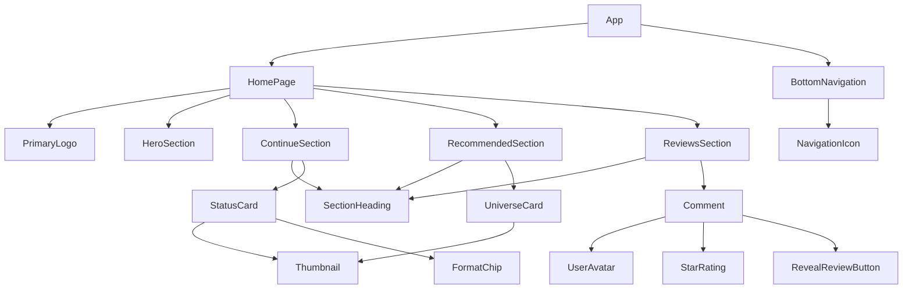

# Inkverse — Component Map

## 1. Objective

This document defines the component structure of Inkverse based on the Figma designs and the exported component metadata.

The goal is to identify reusable components, their variants and how they are organized within the application.

The exported Figma metadata is available in `wireframe-all.md`.

---

## 2. Component hierarchy

Inkverse is organized into pages, sections and reusable components.

### Main application

- `App`
  - `Header`
  - `Page`
  - `BottomNavigation`
  - `OverlayContainer`

### Home page

- `HomePage`
  - `SectionHeading`
  - `StatusCard`
  - `UniverseCard`
  - `WorkCard`
  - `BottomNavigation`

---

## 3. Reusable components

### 3.1. Navigation

| Component | Description | Variants / Properties |
|---|---|---|
| `BottomNavigation` | Main navigation bar with five destinations. | Home, Discovery, Universes, Library, Profile. Each destination has selected and unselected states. |
| `NavigationIcon` | Icon representing a navigation destination. | Selected / Unselected. |
| `SectionHeading` | Section title. A chevron (`>`) indicates that the section can be opened to access another page. Without a chevron, the heading is static. | With chevron / Without chevron. |

The BottomNavigation uses the same five icons throughout the application. Only the selected state changes depending on the current page.

### 3.2. Cards

| Component | Description | Variants / Properties |
|---|---|---|
| `StatusCard` | Displays a work that the user is currently reading or watching, including its cover, title, format, status and progress. | Default / Clicked. |
| `UniverseCard` | Displays a universe with its thumbnail, title, number of works and number of formats. | Default / Pressed. |
| `WorkCard` | Displays an individual book, movie or series. | Default / Pressed. |
| `ListCard` | Displays an item in a list with its title and thumbnail. | Default / Pressed. |
| `SavedUniverseCard` | Displays a saved universe. | Favorite state. |

### 3.3. Reviews and comments

| Component | Description | Variants / Properties |
|---|---|---|
| `ReviewCard` | Displays a user's review, profile image, rating and comment. | Visible / Spoiler. |
| `StarRating` | Displays a rating using stars. | Empty / 1–5 stars. |
| `UserAvatar` | Displays the user's profile picture. | Image instance. |
| `RevealReviewButton` | Allows the user to reveal a review hidden because it contains spoilers. | Default. |

### 3.4. Labels and controls

| Component | Description | Variants / Properties |
|---|---|---|
| `GenreChip` | Displays a genre label. | Default / Fantasy. |
| `FormatChip` | Identifies the format of a work. | Book / Movie. |
| `StatusChip` | Displays the user's progress status for a work. | Want / In progress / Finished / Paused / Dropped. |
| `FidelityChip` | Displays information about the fidelity of an adaptation. | Original / Score variants. |
| `RouteSelector` | Allows the user to select the order in which works are displayed. | Chronological / Recommended / Published. |
| `FidelityToggle` | Allows the user to activate or deactivate fidelity information. | On / Off. |
| `StatusTabs` | Filters works according to their status. | All / Want / In progress / Finished / Paused / Dropped. |
| `FormatTabs` | Filters works according to their format. | All / Books / Movies / Series. |

### 3.5. Basic elements

| Component | Description | Variants / Properties |
|---|---|---|
| `Thumbnail` | Reusable image element used in cards and lists. | Different image instances, such as Prisoner of Azkaban, Dune and His Dark Materials. |
| `Button` | Reusable interactive button. | Depends on its use. |
| `Icon` | Reusable icon element. | Different icon instances. |
| `ProgressBar` | Represents the user's progress through a work. | Progress value. |
| `Badge` | Displays a short label or status. | Original / Finished / In progress / Fidelity. |

---

## 4. Home page component structure

The Home page is composed of the following elements, in order:

- `HomePage`
  - `PrimaryLogo`
  - `HeroSection`
  - `ContinueSection`
    - `SectionHeading`
    - `StatusCard`
      - `Thumbnail`
      - `FormatChip`
  - `RecommendedSection`
    - `SectionHeading`
    - `UniverseCard`
      - `Thumbnail`
  - `ReviewsSection`
    - `SectionHeading`
    - `Comment`
      - `UserAvatar`
      - `StarRating`
      - `RevealReviewButton` (when the comment contains spoilers)
  - `BottomNavigation`

### Home page components

| Component | Description | Properties / Variants |
|---|---|---|
| `PrimaryLogo` | Main Inkverse logo displayed at the top of Home. | One fixed version, no variants. |
| `HeroSection` | Main introductory or welcome section of Home. | One version, no variants. |
| `SectionHeading` | Section title. A chevron (`>`) indicates that the section can be opened to access another page. Without a chevron, the heading is static. | With chevron / Without chevron. |
| `StatusCard` | Displays a work that the user is currently reading or watching, including its thumbnail, title, format and progress. | Default / Clicked. |
| `UniverseCard` | Displays a fictional universe with its thumbnail, title, number of works and number of formats. | Default / Pressed. |
| `Comment` | Displays a user's comment or review, including their profile picture, rating and text. | Default / Spoiler alert / Spoiler revealed. |
| `StarRating` | Displays the rating associated with a comment. | Empty / 1–5 stars. |
| `UserAvatar` | Displays the profile picture of the comment author. | Image instance. |
| `BottomNavigation` | Main navigation bar with five destinations. Each destination has selected and unselected states. | Home / Discover / Universes / Library / Profile. |

### Card structure

**StatusCard**
- Thumbnail
- Title
- Progress
- Format

**UniverseCard**
- Thumbnail
- Title
- Number of works
- Number of formats

### Comment structure

**Comment**
- Username
- User profile picture (`UserAvatar`)
- Rating (`StarRating`)
- Comment text
- Revealed text (when spoilers are hidden)
- Spoiler warning and reveal interaction when applicable.

The Home page uses the following components:

- `HomePage`
  - `Header`
  - `ContinueSection`
    - `SectionHeading`
    - `StatusCard`
      - `Thumbnail`
      - `StatusChip`
      - `ProgressBar`
  - `RecommendedSection`
    - `SectionHeading`
    - `UniverseCard`
      - `Thumbnail`
  - `BottomNavigation`

### Card differences

**StatusCard**

Displays an individual work that the user is reading or watching.

Information:
- Thumbnail
- Work title
- Format
- Current status
- Progress percentage
- Navigation chevron

**UniverseCard**

Displays a fictional universe and its available content.

Information:
- Thumbnail
- Universe title
- Number of works
- Number of formats
- Navigation chevron

---

## 5. Component hierarchy diagram

---

## 6. Notes and implementation considerations

- Components should be reusable across different pages.
- Variants represent different visual or interaction states of the same component.
- `Thumbnail` is a reusable image element, not a separate card.
- `StarRating` and `UserAvatar` are elements used inside review and comment components.
- `GenreChip` represents a genre label and can be reused wherever genres are displayed.
- The five BottomNavigation destinations share the same navigation structure. The active icon changes according to the current page.
- A `SectionHeading` with a chevron indicates navigation to another page. A heading without a chevron is static.
- The component structure may evolve as additional screens and functionality are implemented.
- The original Figma export is kept separately in `wireframe-all.md` as a reference.
