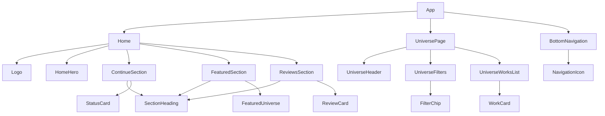

# Inkverse — Component Map

## 1. Objective

This document describes the current component structure of Inkverse based on its React implementation.

The goal is to identify the components currently implemented, their responsibilities and how they are organized within the application.

It also documents the components that are planned for future refactoring.

---

## 2. Component hierarchy

Inkverse is organized into pages and reusable components.

### Main application

- `App`
  - `Home`
  - `UniversePage`
  - `BottomNavigation`

### Home page

- `Home`
  - `Logo`
  - `HomeHero`
  - `SectionHeading`
    - `StatusCard`
  - `SectionHeading`
    - `FeaturedUniverse`
  - `SectionHeading`
    - `ReviewCard`

### Universe page

- `UniversePage`
  - `UniverseHeader` (not yet extracted)
  - `UniverseFilters` (not yet extracted)
    - `FilterChip`
  - `UniverseWorksList` (not yet extracted)
    - `WorkCard`

---

## 3. Implemented reusable components

### 3.1. Atoms

| Component | Description | Properties / Variants |
|---|---|---|
| `Logo` | Displays the Inkverse logo. | Fixed logo. |
| `FilterChip` | Reusable filter button with active and inactive states. | Label / Active / Inactive. |
| `NavigationIcon` | Displays an icon representing a navigation destination. | Selected / Unselected. |

### 3.2. Molecules

| Component | Description | Properties / Variants |
|---|---|---|
| `HomeHero` | Displays the main introductory section of the Home page, including its title and subtitle. | Title / Subtitle. |
| `StatusCard` | Displays a work that the user is currently reading or watching, including its title, format and progress. | Work information / Progress. |
| `UniverseCard` | Displays a universe with its thumbnail, title, number of works and number of formats. | Universe information. |
| `FeaturedUniverse` | Displays a featured universe banner with its cover, title, author, genres and available formats. Includes a favourite button and navigation interaction. | Favourite / Not favourite. |
| `ReviewCard` | Displays a community review. | Review data. |
| `WorkCard` | Displays an individual work within a universe, including its title, year and thumbnail. | Work information. |

### 3.3. Navigation and layout components

| Component | Description | Properties / Variants |
|---|---|---|
| `SectionHeading` | Displays a section title and renders a list of cards according to the component type received. | Title / Data / Navigation callback. |
| `BottomNavigation` | Main navigation bar with five destinations. | Home / Discovery / Universes / Library / Profile. |

The `BottomNavigation` uses the same navigation structure throughout the application. The selected state changes according to the current page.

`SectionHeading` uses a component registry to determine which card component should be rendered for each data type.

---

## 4. Page component structure

### 4.1. Home page

The Home page is composed of the following elements:

- `Home`
  - `Logo`
  - `HomeHero`
  - Continue Reading section
    - `SectionHeading`
    - `StatusCard`
  - Featured Universe section
    - `SectionHeading`
    - `FeaturedUniverse`
  - Reviews section
    - `SectionHeading`
    - `ReviewCard`

#### Home page components

| Component | Description | Properties |
|---|---|---|
| `Logo` | Main Inkverse logo displayed at the top of Home. | Fixed logo. |
| `HomeHero` | Introductory section with a main title and subtitle. | Title / Subtitle. |
| `StatusCard` | Displays a work that the user has started reading or watching. | Title / Format / Progress. |
| `FeaturedUniverse` | Highlights a selected fictional universe. | Title / Author / Cover / Genres / Formats / Favourite state. |
| `ReviewCard` | Displays a community review. | Review data. |
| `SectionHeading` | Organizes and displays the title and content of each Home section. | Title / Data. |

### 4.2. Universe page

The Universe page displays the information and works belonging to a selected fictional universe.

Its current structure is:

- `UniversePage`
  - Universe header
    - Universe title
    - Author
  - Format filters
    - `FilterChip` — All
    - `FilterChip` — Books
    - `FilterChip` — Movies
  - Works list
    - `WorkCard`
  - Empty state message (currently implemented directly in the page)

The page retrieves the selected universe and its associated works from the local JSON data.

#### Universe page functionality

- Displays the selected universe's title and author.
- Counts the available books and movies.
- Filters works by format.
- Displays the corresponding works.
- Shows a message when no works are available for the selected format.

---

## 5. Component hierarchy diagram

Note: `UniverseHeader`, `UniverseFilters` and `UniverseWorksList` are logical sections currently implemented directly inside `UniversePage`, not independent React components yet.

---

## 6. Components pending further decomposition

The current implementation is functional, but some page sections still contain code that could be extracted into reusable components.

The following components are planned for future refactoring:

| Planned component | Description | Current implementation |
|---|---|---|
| `UniverseHeader` | Groups the universe title, author, description and cover. | Currently inside `UniversePage`. |
| `UniverseFilters` | Groups the format filters and their counters. | Currently inside `UniversePage`, using `FilterChip`. |
| `UniverseWorksList` | Manages the list of works and renders `WorkCard` components. | Currently inside `UniversePage`. |
| `EmptyState` | Reusable component for displaying empty lists or unavailable content. | Currently implemented directly inside `UniversePage`. |
| `ProgressBar` | Reusable visual representation of reading or watching progress. | Currently part of `StatusCard`. |
| `ReviewMetadata` | Groups review-related metadata, such as author, rating and date, if required by the final review design. | Not yet extracted. |

These components will be implemented progressively as part of the ongoing component refactoring process.

---

## 7. Notes and implementation considerations

- Components should be reusable whenever the same functionality or visual structure appears in multiple places.
- Components should have a clear and independent responsibility.
- Page components should primarily manage data, state and the composition of other components.
- `SectionHeading` uses a registry to connect data types with their corresponding card components.
- `FilterChip` is reusable and receives its label, active state and click handler through props.
- `WorkCard` receives a work object and its position in the list through props.
- Local JSON files provide the data used by Home and UniversePage.
- Component names and responsibilities may evolve as additional functionality is implemented.

**Implementation status:** The current component structure is still evolving. Some sections of the pages have not yet been extracted into independent components, as described in Section 6.